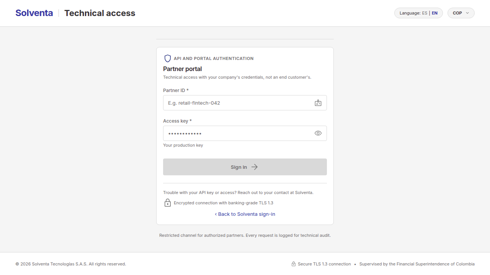
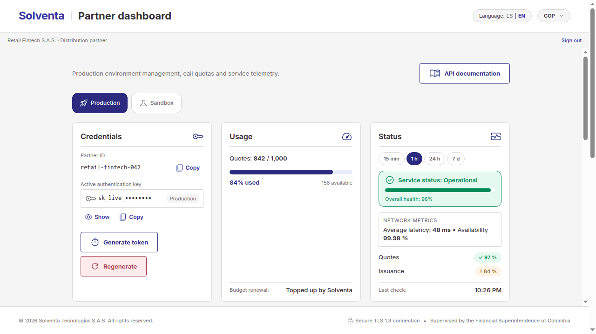
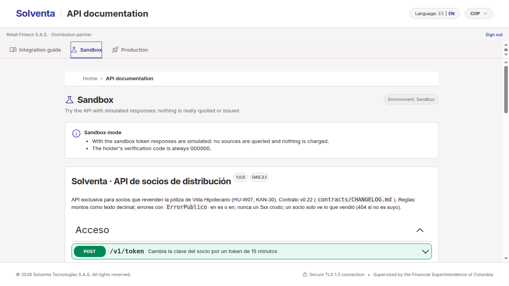

# Integration guide for distribution partners

**Solventa · Partner API v1** (contract v0.22, `contrato/socios-v1.json`) · October 2026

This guide explains how to sell Solventa's **Mortgage Life** policy from your app: how to sign in to the portal, which
credentials to use, how to test without risk, and the full journey of a sale, from the quote to the issued policy. The
exact reference for every endpoint is in the portal's Swagger (the «Sandbox» and «Production» tabs).

> The API field names and values are in Spanish, as the contract defines them (for example, `documentoIdentidad` is the
> holder's ID number and `PRUEBAS` is the sandbox environment).

## 1. What you can do with Solventa

- **Sell the policy from your app.** Your app quotes, the holder accepts, and Solventa assesses, issues and collects.
- **Earn a commission.** For every policy you sell, Solventa accrues a commission equal to the premium times your
  commission rate. The rate is locked when the holder accepts the offer. The dashboard shows the current rate, the
  premiums and the commission earned per month.
- **Know who does what:**

| Your app | The holder | Solventa |
|---|---|---|
| Records their consent and requests a quote | Authorizes the use of their data | Queries the data sources and prices the offer |
| Accepts the offer with the holder's name and email | Reads you the code they receive by email | Sends the code and verifies the identity |
| Requests issuance and checks the status | Signs and pays from the link in their email | Decides the underwriting, collects the premium and issues |
| Downloads the policy | Receives their policy | Accrues your commission |

> Solventa collects the premium. Your app never receives payment data or the holder's signing link.

## 2. Sign in to the portal

Open Solventa's sign-in page and choose **«Are you a distribution partner? Go to the API partner portal»**.



1. **Partner ID:** your production identifier (for example, `retail-fintech-042`).
2. **Access key:** your **production key**. The sandbox key does not open the portal.
3. If the details are wrong, you see a generic message that does not say which one failed. Several failed attempts
   lock sign-in for a while.

A portal session lasts 15 minutes. When it expires, you return to sign-in with the notice «Your technical session
expired».

## 3. Get to know your dashboard



1. **Environment:** «Production» or «Sandbox». It changes the credentials, usage and sales you see.
2. **Credentials:** your ID and key for the selected environment, with «Show», «Copy», «Generate token» and
   «Regenerate».
3. **Usage:** quotes used against your budget. **Only quotes count against the budget**; accepting, verifying, issuing
   and querying do not. The budget does not renew on its own: **Solventa tops it up**.
4. **Status:** overall service health with its color (Operational, Degraded or Failing), availability and average
   latency over the window you choose (15 min, 1 h, 24 h or 7 d), and the health of Quotes and Issuance.
5. **Usage by API:** calls per day and a table with calls, errors and latency for each API.
6. **Sales and commissions:** proposals, policies issued, conversion, premiums, commission and its rate, and the
   monthly breakdown. In the sandbox this data is simulated.

## 4. Your credentials

You have **four credentials**: for each environment (production and sandbox), an ID with its **long key** and the
**short-lived token** you get with them.

| | Long key | Token |
|---|---|---|
| What it is for | Requesting tokens. Keep it on your server, never in the end user's app | Calling the API |
| Lifetime | Until you regenerate it | 15 minutes |
| Environment | One per key | The one of the key you used |

**Request a token:**

```http
POST /v1/token
Content-Type: application/json

{ "clientId": "retail-fintech-042", "clave": "<your production key>" }
```

```json
{ "accessToken": "eyJhbGciOiJFUzI1NiIs…", "tokenType": "Bearer", "expiraEn": "2026-10-29T15:15:00Z", "entorno": "PRODUCCION" }
```

Send it on every call as `Authorization: Bearer <accessToken>` and request a new one before it expires. For the sandbox,
use the sandbox ID and key.

**Regenerating a key without breaking your integration.** «Regenerate» creates a new key and revokes the previous one
immediately: the old key can no longer request tokens. Tokens you already requested stay valid until they expire (15
minutes). To avoid an outage:

1. Regenerate the key in the portal and copy it: it is shown when the operation finishes.
2. Update the key on your server before the last token requested with the old key expires.
3. Request the next token with the new key.

## 5. Test without risk



In the portal, **«API documentation» → «Sandbox»** opens the Swagger with your sandbox token: you can try every endpoint
with «Try it out». With a **sandbox** (`PRUEBAS`) token:

- responses are **simulated**: no data sources are queried and nothing is charged;
- the holder's verification code is always **`000000`**;
- the dashboard's sales and commissions are sample data.

Sandbox quotes count against your **sandbox** budget, not the production one.

## 6. Sell a policy step by step

Every call carries `Authorization: Bearer <token>`. Amounts are decimal text with their currency (`"185000.00"`,
`"COP"`). Send `Accept-Language: es` or `en` to get the messages in that language.

```text
consent → quote → proposal → code → issue → the holder signs and pays → check status → policy
                                    ACEPTADA → IDENTIDAD_VERIFICADA → EN_FIRMA → FIRMADA → … → EMITIDA
```

**1. Consent.** Without the holder's valid consent no data source is queried. It is recorded as granted through your
company and expires after 30 days.

```http
POST /v1/consentimientos
{ "documentoIdentidad": "1020789456", "finalidad": "cotizacion-seguro-vida-hipotecario", "versionTexto": "v1" }
```

It returns `201` with the consent `id`, its `estado` (`VIGENTE`) and `venceEn`. If the holder withdraws it:
`POST /v1/consentimientos/{consentimientoId}/revocar`.

**2. Quote.** It is the only operation that counts against the budget.

```http
POST /v1/cotizaciones
{
  "consentimientoId": "<id from step 1>",
  "documentoIdentidad": "1020789456",
  "valorCredito": "185000000.00",
  "plazoMeses": 48,
  "direccionInmueble": "Calle 80 # 10-20, Bogotá"
}
```

The response has the `oferta` and the `presupuestoRestante` (remaining budget):

- **COMPLETA** (complete): it has the `prima` (premium). It can be accepted.
- **PRELIMINAR** (preliminary): a data source did not respond. It has a `rangoPrima` (premium range) and **cannot be
  accepted**; quote again later.

The term goes from 1 to 60 months and the ID number has at least 6 digits.

**3. Proposal.** Accept a COMPLETA offer with the holder's name and email. Solventa stores them encrypted and deletes
them if the policy is not issued and the consent is revoked.

```http
POST /v1/propuestas
{ "ofertaId": "<offer id>", "contacto": { "nombre": "Carlos Restrepo", "correo": "carlos@correo.com" } }
```

It returns `201` with the proposal in `ACEPTADA` status.

**4. Verification code.** Solventa emails a 6-digit code to the holder, and the holder reads it to you.

```http
POST /v1/propuestas/{propuestaId}/codigo
{ "correo": null }
```

If the email was wrong, send the corrected one in `correo`; with `null` the proposal's email is used. The response has
the masked email and when the code expires. Then verify it:

```http
POST /v1/propuestas/{propuestaId}/codigo/verificar
{ "codigo": "000000" }
```

If it is right, the proposal moves to `IDENTIDAD_VERIFICADA`. A wrong or expired code, or one with no attempts left,
returns an error with its `codigo` (`CODIGO_INVALIDO`, `CODIGO_VENCIDO` or `INTENTOS_AGOTADOS`).

**5. Issue.** Solventa decides the underwriting and, if approved, sends the holder the signing and payment link.

```http
POST /v1/propuestas/{propuestaId}/emitir
```

- Approved: the proposal moves to `EN_FIRMA` and the response says which (masked) email the link was sent to.
- Not approved: it stays `EN_REVISION` or `NO_EMITIDA`, with a `mensajeEstado` you can show the holder.

Repeating the call does not decide again. If the holder did not get the link or it expired:
`POST /v1/propuestas/{propuestaId}/reenviar-enlace`.

**6. The holder signs and pays from their email.** The link lasts 30 minutes. **The URL never reaches your app**: the
holder signs and pays directly with Solventa.

**7. Check the status.** There are no webhooks: poll the proposal from time to time until it reaches a final status
(`EMITIDA`, `NO_EMITIDA` or `CANCELADA`).

```http
GET /v1/propuestas/{propuestaId}
```

For your UI, use `estadoVisible` (`EMITIENDO`, `EMITIDA` or `NO_EMITIDA`) and `mensajeEstado`. The `enlace` field says
whether the holder's link is still valid. Once issued, the proposal includes the `polizaId`.

**8. Download the policy.**

```http
GET /v1/polizas/{polizaId}
GET /v1/polizas/{polizaId}/documento
```

The first returns the number, line of business, validity, premium and coverage; the second, the PDF. You can only see
the proposals and policies you sold: the rest return `404`.

## 7. Go live

In the portal, the Swagger's **«Production»** tab uses your production token. There, **every quote uses up real
budget**.

Before going live, check that:

- [ ] the production key lives only on your server, and your app requests tokens from your server;
- [ ] you renew the token before the 15 minutes are up;
- [ ] you record the holder's consent before quoting;
- [ ] you treat a PRELIMINAR offer as «try again», not as an error;
- [ ] you handle the `429` for an exhausted budget (see section 8);
- [ ] you poll the proposal until a final status, without polling too often;
- [ ] you have enough budget on the dashboard or asked Solventa for a top-up.

## 8. Limits and errors

Every error comes with the same body, `ErrorPublico`:

```json
{ "codigo": "PRESUPUESTO_AGOTADO", "mensaje": "…", "puedeReintentar": false, "intentosRestantes": null }
```

Decide with `codigo`, never with the text of `mensaje`, which is meant for display and changes with the language.

| HTTP | `codigo` | What happened | What to do |
|---|---|---|---|
| 401 | `CREDENCIALES_INVALIDAS` | Wrong ID or key when requesting the token | Check the environment's credentials |
| 401 | `TOKEN_INVALIDO` | The token is missing, expired or invalid | Request a new token |
| 403 | `PROHIBIDO` | The operation is not allowed with that token | Use the token of the right environment |
| 404 | `NO_ENCONTRADO` | It does not exist or you did not sell it | — |
| 409 | `CONSENTIMIENTO_NO_VIGENTE`, `OFERTA_PRELIMINAR`, `OFERTA_VENCIDA`, `PROPUESTA_NO_VALIDA`… | The step does not apply in the current status | Repeat the corresponding previous step |
| 422 | `DATOS_INVALIDOS`, `CONTACTO_INVALIDO`, `CODIGO_INVALIDO`… | Some data is not valid | Fix the data |
| 429 | `PRESUPUESTO_AGOTADO` | You have no quote budget left | Wait for what `Retry-After` says or ask Solventa for a top-up |
| 503 | `SERVICIO_NO_DISPONIBLE` | Controlled internal failure | Retry after what `Retry-After` says |

The API **never returns a bare 5xx**: on an internal failure it returns `503` with `puedeReintentar: true` and
`Retry-After`. If `puedeReintentar` is `true`, you can repeat the call.

**Service status.** Before opening an incident, check the dashboard's «Status» card. If Quotes or Issuance are yellow or
red, the problem may be Solventa's or a provider's, and offers may come back PRELIMINAR while it lasts.

## 9. Help

If you have questions about your integration, budget or credentials, write to your account contact at Solventa. Have
your partner ID at hand and, for an error, the `codigo` you received and the time of the call. Never share your key or
your tokens.
