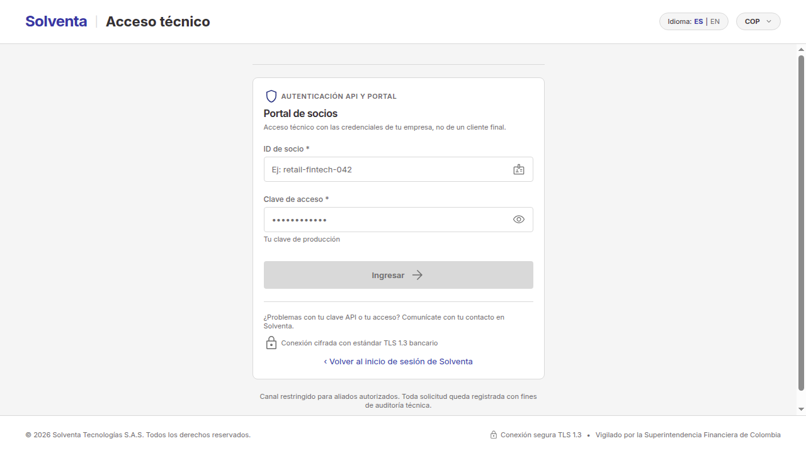
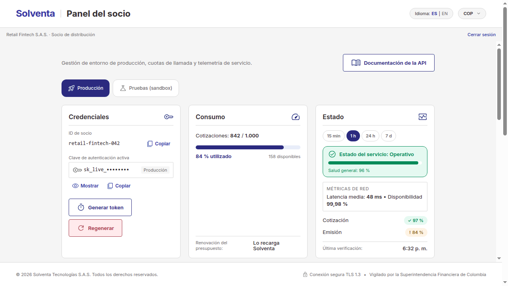
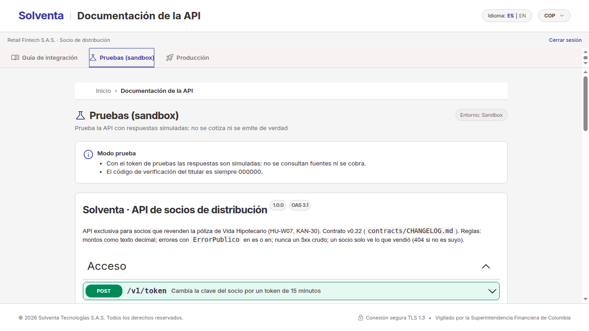

# Guía de integración para socios de distribución

**Solventa · API de socios v1** (contrato v0.22, `contrato/socios-v1.json`) · octubre de 2026

Esta guía explica cómo vender la póliza de **Vida Hipotecario** de Solventa desde tu app: cómo entrar al portal, qué
credenciales usar, cómo probar sin riesgo y cómo es el recorrido completo de una venta, de la cotización a la póliza
emitida. La referencia exacta de cada endpoint está en el Swagger del portal (pestañas «Pruebas» y «Producción»).

## 1. Qué puedes hacer con Solventa

- **Vender la póliza desde tu app.** Tu app cotiza, el titular acepta y Solventa evalúa, emite y cobra.
- **Ganar una comisión.** Por cada póliza que vendes, Solventa causa una comisión igual a la prima multiplicada por tu
  tasa de comisión. La tasa se congela en el momento en que el titular acepta la oferta. El panel muestra la tasa
  vigente, las primas y la comisión causada por mes.
- **Saber qué hace cada parte:**

| Tu app | El titular | Solventa |
|---|---|---|
| Registra su consentimiento y cotiza | Autoriza la consulta de sus datos | Consulta las fuentes y calcula la oferta |
| Acepta la oferta con el nombre y el correo del titular | Te dicta el código que le llega al correo | Envía el código y verifica la identidad |
| Pide la emisión y consulta el estado | Firma y paga desde el enlace de su correo | Decide la suscripción, cobra la prima y emite |
| Descarga la póliza | Recibe su póliza | Causa tu comisión |

> Solventa cobra la prima. Tu app nunca recibe datos de pago ni el enlace de firma del titular.

## 2. Entra al portal

Abre el inicio de sesión de Solventa y elige **«¿Eres un socio de distribución? Ingresa al portal de socios API»**.



1. **ID de socio:** tu identificador de producción (por ejemplo, `retail-fintech-042`).
2. **Clave de acceso:** tu **clave de producción**. Con la clave de pruebas no se entra al portal.
3. Si los datos no son correctos, verás un mensaje genérico que no dice cuál de los dos falló. Varios intentos fallidos
   bloquean el ingreso por un tiempo.

La sesión del portal dura 15 minutos. Al vencer, vuelves al ingreso con el aviso «Tu sesión técnica venció».

## 3. Conoce tu panel



1. **Entorno:** «Producción» o «Pruebas (sandbox)». Cambia las credenciales, el consumo y las ventas que ves.
2. **Credenciales:** tu ID y tu clave del entorno elegido, con «Mostrar», «Copiar», «Generar token» y «Regenerar».
3. **Consumo:** las cotizaciones usadas frente a tu presupuesto. **Solo las cotizaciones descuentan presupuesto**;
   aceptar, verificar, emitir y consultar no. El presupuesto no se renueva solo: **lo recarga Solventa**.
4. **Estado:** la salud general del servicio con su color (Operativo, Degradado o Con fallas), la disponibilidad y la
   latencia media en la ventana que elijas (15 min, 1 h, 24 h o 7 d), y la salud de Cotización y de Emisión.
5. **Consumo por API:** llamadas por día y una tabla con llamadas, errores y latencia de cada API.
6. **Ventas y comisiones:** propuestas, pólizas emitidas, conversión, primas, comisión y su tasa, y el detalle por mes.
   En el entorno de pruebas estos datos son simulados.

## 4. Tus credenciales

Tienes **cuatro credenciales**: por cada entorno (producción y pruebas), un ID con su **clave larga** y el **token
corto** que obtienes con ellos.

| | Clave larga | Token |
|---|---|---|
| Para qué sirve | Pedir tokens. Guárdala en tu servidor, nunca en la app del usuario | Llamar a la API |
| Duración | Hasta que la regeneres | 15 minutos |
| Entorno | Uno por clave | El de la clave con que lo pediste |

**Pide un token:**

```http
POST /v1/token
Content-Type: application/json

{ "clientId": "retail-fintech-042", "clave": "<tu clave de producción>" }
```

```json
{ "accessToken": "eyJhbGciOiJFUzI1NiIs…", "tokenType": "Bearer", "expiraEn": "2026-10-29T15:15:00Z", "entorno": "PRODUCCION" }
```

Úsalo en cada llamada con `Authorization: Bearer <accessToken>` y pide uno nuevo antes de que venza. Para el entorno de
pruebas usa el ID y la clave de pruebas.

**Regenerar una clave sin romper tu integración.** «Regenerar» crea una clave nueva y revoca la anterior de inmediato:
con la clave vieja ya no se pueden pedir tokens. Los tokens que ya pediste siguen valiendo hasta que vencen (15
minutos). Para no cortar el servicio:

1. Regenera la clave en el portal y cópiala: se muestra al terminar.
2. Actualiza la clave en tu servidor antes de que venza el último token que pediste con la anterior.
3. Pide el siguiente token con la clave nueva.

## 5. Prueba sin riesgo



En el portal, **«Documentación de la API» → «Pruebas (sandbox)»** abre el Swagger con tu token de pruebas: puedes
probar cada endpoint con «Try it out». Con un token de **PRUEBAS**:

- las respuestas son **simuladas**: no se consultan fuentes de datos ni se cobra;
- el código de verificación del titular es siempre **`000000`**;
- las ventas y comisiones del panel son datos de ejemplo.

Las cotizaciones de pruebas descuentan de tu presupuesto **de pruebas**, no del de producción.

## 6. Vende una póliza paso a paso

Todas las llamadas llevan `Authorization: Bearer <token>`. Los montos van como texto decimal con su moneda
(`"185000.00"`, `"COP"`). Puedes mandar `Accept-Language: es` o `en` para recibir los mensajes en ese idioma.

```text
consentimiento → cotización → propuesta → código → emitir → el titular firma y paga → consultar → póliza
                                            ACEPTADA → IDENTIDAD_VERIFICADA → EN_FIRMA → FIRMADA → … → EMITIDA
```

**1. Consentimiento.** Sin un consentimiento vigente del titular no se consulta ninguna fuente. Queda registrado que lo
otorgó tu empresa y vence a los 30 días.

```http
POST /v1/consentimientos
{ "documentoIdentidad": "1020789456", "finalidad": "cotizacion-seguro-vida-hipotecario", "versionTexto": "v1" }
```

Responde `201` con el `id` del consentimiento, su `estado` (`VIGENTE`) y `venceEn`. Si el titular lo retira:
`POST /v1/consentimientos/{consentimientoId}/revocar`.

**2. Cotización.** Es la única operación que descuenta presupuesto.

```http
POST /v1/cotizaciones
{
  "consentimientoId": "<id del paso 1>",
  "documentoIdentidad": "1020789456",
  "valorCredito": "185000000.00",
  "plazoMeses": 48,
  "direccionInmueble": "Calle 80 # 10-20, Bogotá"
}
```

La respuesta trae la `oferta` y el `presupuestoRestante`:

- **COMPLETA:** trae la `prima`. Se puede aceptar.
- **PRELIMINAR:** alguna fuente no respondió. Trae un `rangoPrima` y **no se puede aceptar**; vuelve a cotizar más
  tarde.

El plazo va de 1 a 60 meses y el documento tiene al menos 6 dígitos.

**3. Propuesta.** Acepta una oferta COMPLETA con el nombre y el correo del titular. Solventa los guarda cifrados y los
borra si la póliza no se emite y se revoca el consentimiento.

```http
POST /v1/propuestas
{ "ofertaId": "<id de la oferta>", "contacto": { "nombre": "Carlos Restrepo", "correo": "carlos@correo.com" } }
```

Responde `201` con la propuesta en estado `ACEPTADA`.

**4. Código de verificación.** Solventa envía un código de 6 dígitos al correo del titular, y el titular te lo dicta.

```http
POST /v1/propuestas/{propuestaId}/codigo
{ "correo": null }
```

Si el correo estaba mal, mándalo corregido en `correo`; con `null` se usa el de la propuesta. La respuesta trae el
correo enmascarado y cuándo vence el código. Luego verifícalo:

```http
POST /v1/propuestas/{propuestaId}/codigo/verificar
{ "codigo": "000000" }
```

Si es correcto, la propuesta pasa a `IDENTIDAD_VERIFICADA`. Un código equivocado, vencido o con los intentos agotados
responde un error con su `codigo` (`CODIGO_INVALIDO`, `CODIGO_VENCIDO` o `INTENTOS_AGOTADOS`).

**5. Emitir.** Solventa decide la suscripción y, si la aprueba, envía al titular el enlace de firma y pago.

```http
POST /v1/propuestas/{propuestaId}/emitir
```

- Aprobada: la propuesta queda `EN_FIRMA` y la respuesta dice a qué correo (enmascarado) se envió el enlace.
- No aprobada: queda `EN_REVISION` o `NO_EMITIDA`, con un `mensajeEstado` que puedes mostrarle al titular.

Repetir la llamada no vuelve a decidir. Si el titular no recibió el enlace o se le venció:
`POST /v1/propuestas/{propuestaId}/reenviar-enlace`.

**6. El titular firma y paga desde su correo.** El enlace dura 30 minutos. **La URL nunca llega a tu app**: el titular
firma y paga directamente con Solventa.

**7. Consulta el estado.** No hay webhooks: consulta la propuesta cada cierto tiempo hasta que llegue a un estado final
(`EMITIDA`, `NO_EMITIDA` o `CANCELADA`).

```http
GET /v1/propuestas/{propuestaId}
```

Para tu interfaz usa `estadoVisible` (`EMITIENDO`, `EMITIDA` o `NO_EMITIDA`) y `mensajeEstado`. El campo `enlace` dice si
el enlace del titular sigue vigente. Al emitirse, la propuesta trae el `polizaId`.

**8. Descarga la póliza.**

```http
GET /v1/polizas/{polizaId}
GET /v1/polizas/{polizaId}/documento
```

El primero da el número, el ramo, la vigencia, la prima y la cobertura; el segundo, el PDF. Solo puedes ver las
propuestas y pólizas que vendiste tú: las demás responden `404`.

## 7. Pasa a producción

En el portal, la pestaña **«Producción»** del Swagger usa tu token de producción. Ahí **cada cotización descuenta
presupuesto real**.

Antes de salir en vivo, revisa que:

- [ ] la clave de producción vive solo en tu servidor y tu app pide los tokens a tu servidor;
- [ ] renuevas el token antes de los 15 minutos;
- [ ] registras el consentimiento del titular antes de cotizar;
- [ ] tratas la oferta PRELIMINAR como «vuelve a intentar», no como un error;
- [ ] manejas el `429` de presupuesto agotado (ver la sección 8);
- [ ] consultas el estado de la propuesta hasta un estado final, sin consultas demasiado seguidas;
- [ ] tienes presupuesto suficiente en el panel o pediste a Solventa una recarga.

## 8. Límites y errores

Todos los errores llegan con el mismo cuerpo, `ErrorPublico`:

```json
{ "codigo": "PRESUPUESTO_AGOTADO", "mensaje": "…", "puedeReintentar": false, "intentosRestantes": null }
```

Decide con `codigo`, nunca con el texto de `mensaje`, que está pensado para mostrar y cambia con el idioma.

| HTTP | `codigo` | Qué pasó | Qué hacer |
|---|---|---|---|
| 401 | `CREDENCIALES_INVALIDAS` | ID o clave incorrectos al pedir el token | Revisa las credenciales del entorno |
| 401 | `TOKEN_INVALIDO` | Falta el token, venció o no es válido | Pide un token nuevo |
| 403 | `PROHIBIDO` | La operación no está permitida con ese token | Usa el token del entorno correcto |
| 404 | `NO_ENCONTRADO` | No existe o no lo vendiste tú | — |
| 409 | `CONSENTIMIENTO_NO_VIGENTE`, `OFERTA_PRELIMINAR`, `OFERTA_VENCIDA`, `PROPUESTA_NO_VALIDA`… | El paso no aplica en el estado actual | Repite el paso anterior que corresponda |
| 422 | `DATOS_INVALIDOS`, `CONTACTO_INVALIDO`, `CODIGO_INVALIDO`… | Algún dato no es válido | Corrige los datos |
| 429 | `PRESUPUESTO_AGOTADO` | No te queda presupuesto de cotizaciones | Espera lo que diga `Retry-After` o pide una recarga a Solventa |
| 503 | `SERVICIO_NO_DISPONIBLE` | Falla interna controlada | Reintenta después de lo que diga `Retry-After` |

La API **nunca responde un 5xx sin cuerpo**: ante una falla interna responde `503` con `puedeReintentar: true` y
`Retry-After`. Si `puedeReintentar` es `true`, puedes repetir la llamada.

**Estado del servicio.** Antes de abrir un incidente, mira la tarjeta «Estado» del panel. Si Cotización o Emisión están
en amarillo o rojo, el problema puede ser de Solventa o de un proveedor, y las ofertas pueden llegar PRELIMINAR mientras
dura.

## 9. Ayuda

Si tienes dudas sobre tu integración, tu presupuesto o tus credenciales, escríbele a tu contacto comercial en
Solventa. Ten a mano tu ID de socio y, si es un error, el `codigo` que recibiste y la hora de la llamada. Nunca compartas
tu clave ni tus tokens.
